 
 
 
 
 
 
 
 
 
 
 

Character: "Cyber Samurai" by [KhoaMinh](https://sketchfab.com/duongminhkhoa231), licensed under [CC BY 4.0](https://creativecommons.org/licenses/by/4.0/); changes: rendered to animation frames with added lighting and a procedural idle motion. Made with [Starforge](https://github.com/ShyneChikwapulo/Starforge).
