 
 
 
 
 
 
 

Character: "10000 Followers! Milestone - Shade of Neo-Tokyo" by [Moon dong hwa](https://sketchfab.com/moondonghwa), licensed under [CC BY 4.0](https://creativecommons.org/licenses/by/4.0/); changes: speech bubble removed, rendered to animation frames. Made with [Starforge](https://github.com/ShyneChikwapulo/Starforge).
