 
 
 
 
 
 
 

Character: "Cyber Samurai" by [KhoaMinh](https://sketchfab.com/duongminhkhoa231), licensed under [CC BY 4.0](https://creativecommons.org/licenses/by/4.0/); changes: rendered to animation frames with added lighting and a procedural idle motion. Atom: ["Github_kitten"](https://sketchfab.com/3d-models/github-kitten-83d5a6d1a12b4427bbfd662fbc478f8d) by [m.adityamondal2003](https://sketchfab.com/m.adityamondal2003), licensed under [CC BY 4.0](https://creativecommons.org/licenses/by/4.0/); changes: posed at rest, rescaled and resampled as points. Language logos from [Devicon](https://devicon.dev) (MIT). Made with [Starforge](https://github.com/ShyneChikwapulo/Starforge).
